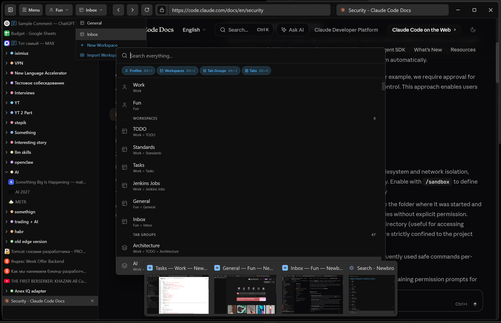
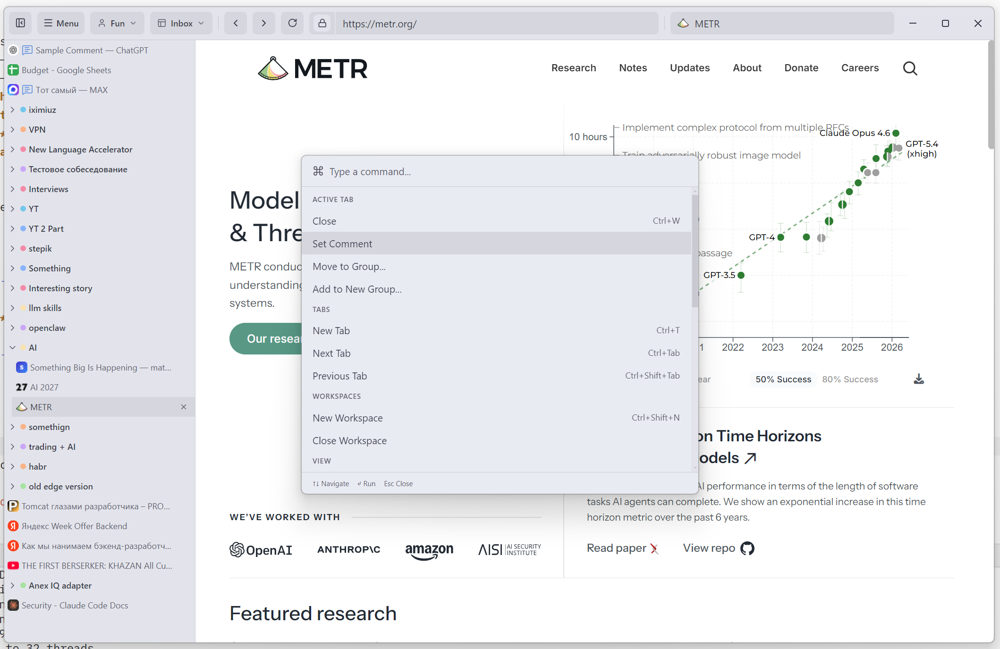
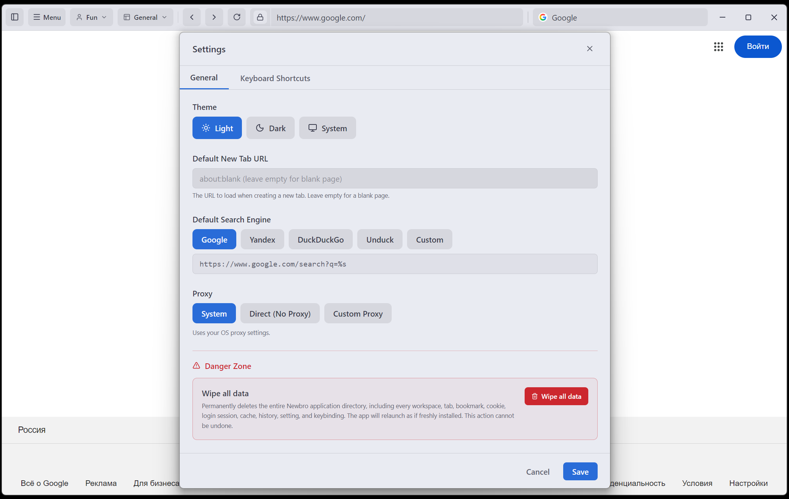

# Vimperium

A keyboard-first desktop browser that runs on Vim keys and nothing else, built with Electron, React and TypeScript. Organize your tabs into colorful groups across multiple isolated workspaces and profiles, and do all of it without the mouse.



## Features

- **Vim-style keys** — Vim's COMMAND and INSERT modes are all there is (no regular-shortcuts mode to switch to), and every action has a key: `j`/`k` scroll, `Ctrl+d`/`Ctrl+u` move half a page, and a prefix is a verb (`n` new, `d` close, `o` open, `t` toggle; `u` brings back a closed tab). `?` lists them all, and Settings → Keyboard Shortcuts rebinds them
- **Profiles** — separate session partitions keep cookies and logins isolated
- **Workspaces** — switch between independent workspaces (work, personal, projects)
- **Tab groups** — color-coded, collapsible groups with drag-and-drop reordering
- **Search Everything** — fuzzy-search all profiles, workspaces, groups and tabs
- **Command palette** — fuzzy-search all commands
- **Tab comments** — annotate any tab with a short note
- **Import workspace** — bring tab groups in from exported browser bookmarks
- **Dark pages** — a built-in dark mode for web pages: Chromium darkens each page as it paints (no white flash, no slowdown, frames included), sites with a dark theme of their own show it, and the moon in the address bar sets it per site, with brightness, contrast and warmth

<details>
<summary>More screenshots</summary>

**Command Palette**



**Settings dialog**



</details>

## Tech stack

Electron 41 · React 19 · TypeScript · Vite · Tailwind CSS · Zustand · dnd-kit

## Getting started

```bash
npm install
npm run dev
```

## Building

```bash
npm run dist:win    # Windows installer
npm run dist:mac    # macOS dmg
npm run dist:linux  # Linux AppImage
```
